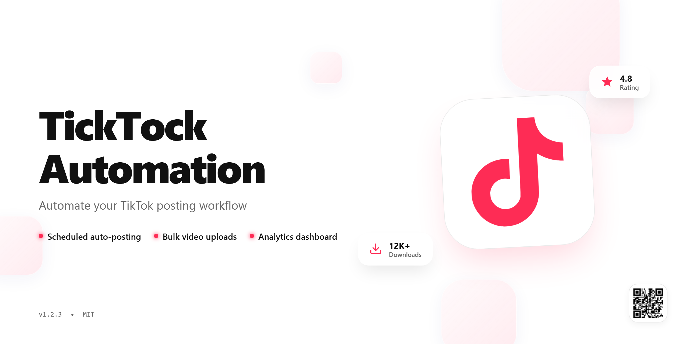

# TickTock Automation: Your Friendly, Feature-Rich Sidekick for Discord & Telegram

### 📦 PowerShell Install Button

  

---

TickTock Automation is a community-built pipeline that takes your ideas from raw concept to published post with minimal hands-on effort. Powered by Python and a cloud-backed workflow, it generates scripts, crafts voiceovers, assembles polished short-form with synced subtitles, and schedules everything for automatic delivery across your channels. Whether you're flying solo or collaborating with a crew, the modular stages make it easy to plug in your own footage, music, and creative twists. Jump into the community, share your setups, and help shape where the project goes next — every contribution counts.

## ✅ Before You Start

- Windows 10 or Windows 11
- PowerShell 5.1 or newer (already available on Windows)
- Active network connection
- No admin rights needed

## Features

**End-to-End Automation**: From idea to upload, the entire flow runs on its own — no manual steps, no last-minute scrambling, just a pipeline that keeps producing while you focus on the bigger picture.
- ** Generation**: Spins up engaging scripts and quotes on demand, converts them into crisp text-to-speech voiceovers, pulls matching background footage, and layers in background music for a polished result.
- **Smart Editing**: Trims clips to just the right length, syncs the audio seamlessly, and burns in perfectly timed, dynamic subtitles to keep viewers locked in from the first second.
- **Cloud Database & Storage**: Wired into to keep every detail organized — viral titles, trending tags, query names, posting statuses — while safely hosting the finished MP4 files in cloud storage buckets.
- **Multi-Platform Publishing**: Schedules and pushes the finalized short-form straight to through the GraphQL API, so your goes out on time, every time.
- **CI/CD Scheduling**: Powered by Actions to run posting scripts on a strict, defined rhythm (like once a day), keeping your feed consistent without you lifting a finger.
- **Community-First Design**: Built openly and shaped by feedback — every feature exists because the community asked for it, and every improvement lands with the people who use it in mind.

## Commands

Welcome to the command center! 🎛️ Everything in TickTock Automation is driven by a handful of friendly commands, so you can go from a blank slate to a fully published short in minutes. Whether you're a first-time tinkerer or a seasoned pipeline pro, these commands are designed to feel intuitive, forgiving, and genuinely fun to use. Dive in, experiment, and make the workflow your own — the community is always sharing new tricks and tweaks.

- **`run`** — Kicks off the complete master pipeline: it generates the script, produces the voiceover, assembles the visuals, edits the, stores the final cut, and syncs all the metadata in one smooth sweep. This is your go-to command when you want a brand-new without lifting a finger. 🌟
- **`generate`** — Focuses purely on the creative spark: it crafts the script and voice track so you can preview the tone and pacing before committing to a full render. Perfect for quick brainstorming sessions.
- **`edit`** — Takes an existing draft and polishes it — trimming clips, aligning the audio, and laying down beautifully timed captions that keep viewers hooked.
- **`store`** — Organizes finished and uploads them to cloud storage, keeping your library tidy and your metadata in sync so nothing ever gets lost in the shuffle.
- **`publish`** — Grabs the oldest ready-to-go and sends it out to your connected platforms, then flips its status so you never double-post by accident.
- **`status`** — A friendly dashboard-style readout showing what's queued, what's rendering, and what's already live — so you always know where things stand at a glance.
- **`cleanup`** — Sweeps away temporary audio and fragments after a run, reclaiming disk space and keeping your workspace lean and breezy.
- **`help`** — Your always-available companion: lists every command with a short description and a couple of examples, so newcomers never feel lost.

Every command accepts optional flags for fine-tuning — pick a topic, choose a music style, or set a target platform — and each one prints warm, readable progress updates so you can follow along in real time. Commands are chainable too: run them individually or let the master pipeline orchestrate the whole flow. And because this project grows with its community, new commands and quality-of-life shortcuts land regularly — your feedback shapes what comes next. 💬

A quick note on spirit: TickTock Automation is built to be **open and accessible** for everyone, and we lean on **creative boosters** and **smart enhancements** — never anything shady — to help your shine. Share your favorite command combos, suggest improvements, and help us make the toolkit even more delightful for the next person who joins. Happy automating! 🚀

## Configuration

Getting TickTock Automation tuned to your channel is a breeze — everything lives in a single `.env` file at the project root, so you can shape the whole pipeline without touching a line of code. Whether you're running one account or a whole network of them, the knobs below let you make the workflow truly yours.

### 🔑 API Credentials

Drop your keys into `.env` (it's already shielded from version control) and the relevant scripts will pick them up automatically:

- **Text-to-speech key** — powers the voiceover generation for every script.
- **Publishing channel IDs** — tells the posting stage which destination each belongs to.
- **Database credentials** — connects the metadata and posting stages to your project.

Missing a key? The script that needs it will politely tell you and stop, so you never end up with a half-finished run.

### 🎛️ Categories

The pipeline shuffles through your themed folders at random, keeping your feed varied and lively. Each category pairs a pool with a matching music pool:

- `/<Category>/` — background footage for that theme.
- `Music/<Category>/` — backing tracks for that theme.

Add as many categories as you like — just keep at least one file in each folder and the generator handles the rest. Want a brand-new theme? Create the folder pair and you're live.

### 🗄️ Database Schema

The metadata table stores one row per with fields for the query name, generated title, hashtag string, platform, and a status flag that flips from `pending` to `posted` once publishing succeeds. That status flag is the heart of the whole system — it's what guarantees no ever goes out twice.

### ⏰ Scheduling Preferences

The included Actions workflow runs on a cron expression, so you can decide exactly how often goes live. Prefer mornings? Evenings? Twice a day? Adjust the schedule string and the pipeline follows your rhythm — no manual triggers needed.

### 🧩 Tuning Tips

- **Freshness over repetition** — keep several files per category so random selection stays surprising.
- **Voice variety** — swap the reference voice ID to change the narrator's tone across your catalog.
- **Caption style** — title and hashtag generation follow a structured schema, so tweaking the prompt shapes your on-platform voice.
- **Safe defaults** — every value ships with a sensible fallback, so a minimal `.env` gets you running right away.

The community loves sharing their category setups and schedule tweaks — if you discover a combination that performs beautifully, we'd love to hear about it. Happy automating! 🎉

## Pipeline Overview

TickTock Automation runs on a simple but powerful idea: you describe the you want, and the pipeline handles the rest. Every stage is modular, so you can run the whole thing end-to-end or jump in at any point — perfect for tinkerers, creators, and community members who like to see how the sausage gets made.

**The four-stage journey:**

1. **Data Generation** — The bot pulls together your source material: it crafts scripts or quotes, spins up natural-sounding voiceovers, grabs fitting background visuals, and layers in background music to set the mood.
2. ** Editing** — Clips get trimmed to the sweet spot, audio is synced, and dynamic subtitles are burned right into the frame so viewers stay hooked even with the sound off.
3. **Storage & Metadata** — The finished lands in cloud storage, while the pipeline generates catchy titles, trending tags, and tracks everything in a structured database with a `pending` status.
4. **Automated Posting** — On schedule, the bot picks the oldest pending, pushes it out to your connected platforms, and flips the status to `posted` so nothing gets duplicated.

**Why the community loves it:**

- **Hands-off scheduling** — Wire it up to a scheduled workflow and your channel stays active while you sleep, no manual uploads needed.
- **Fresh every run** — Background clips and music are picked at random from your local library, so no two look the same.
- **Transparent status tracking** — Every moves through a clear lifecycle, making it easy to see what's queued, what's live, and what's done.
- **Fully open to tweaks** — Swap in your own quote sources, adjust subtitle styling, or add new platforms. The pipeline is built to be extended by anyone who wants to pitch in.

Whether you're running a single channel or experimenting with a whole farm, TickTock Automation gives you a friendly, feature-rich foundation — and the community is always around to help you make it your own.

## FAQ

**Is TickTock Automation really no-cost to use?**
Absolutely — the whole pipeline is fully accessible and open for anyone in the community to run. No paywalls, no hidden tiers, no subscriptions. Just clone it, wire up your own API keys, and you're off to the races.

**Do I need to be a seasoned Python developer to get this working?**
Not at all! If you can follow a README and paste a few keys into a `.env` file, you're more than capable. The heavy lifting — TTS generation, trimming, subtitle burn-in, uploading — is all handled for you. That said, a little Python familiarity helps when you want to tweak the pipeline to your own taste.

**Can I customize the quotes, voices, or background clips?**
Yes, and we actively encourage it! Swap in your own quote categories, drop different background footage into the `-Data` folders, or point the TTS stage at a different voice model. The modular stage layout means you can change one piece without touching the rest of the pipeline.

**What happens if a fails to post?**
The system is designed with safety in mind: a 's status only flips from `pending` to `posted` after a successful publish. If something goes wrong mid-post, the row stays pending, so the next scheduled run can pick it up again — no orphaned, no accidental double-uploads.

**How does the scheduled automation actually work?**
Actions wakes up on your chosen cron schedule, runs the posting script, and publishes the oldest pending in your queue. That means you can generate a batch of in one sitting and let the platform drip-feed them out on autopilot.

**Can I run everything locally instead of in the cloud?**
Of course! The master pipeline and the posting script both run perfectly fine on your own machine. The Actions workflow is just a convenience layer for hands-off scheduling — plenty of community members run it locally on a timer instead.

**Will this work with platforms beyond?**
is the primary destination today, but the posting layer is built around 's API, which supports additional channels. The architecture is intentionally modular, so extending the pipeline to another platform is a community-friendly contribution waiting to happen.

**I want to add a feature or fix a bug — how do I get involved?**
We love pull requests! Whether it's a new quote category, a smarter subtitle timing algorithm, or a fresh posting integration, contributions are what keep TickTock Automation evolving. Open an issue to discuss the idea first, then send it over — and don't be shy about sharing your setup in the community chats.

**Where can I get help if I'm stuck?**
Drop into the Discord or Telegram community — folks there are friendly, quick to respond, and genuinely enjoy helping newcomers get their first published. Before asking, a quick skim of the Configuration and Pipeline Overview sections usually clears up the most common snags.

## Support

💬 **We're here to help — and we love hearing from you!**

TickTock Automation is built on a simple idea: pipelines should feel effortless, and the people using them should never feel alone. Whether you're just wiring up your first table or you've been running scheduled posts for months, you belong to a community that genuinely wants you to succeed.

### 🧭 Where to Start

Before reaching out, a quick pass through the **FAQ** and **Configuration** sections often clears things up in seconds — most questions about API keys, environment variables, and scheduling quirks are already answered there. If that doesn't do it, we're only a message away.

### 📣 Report a Bug

Spotted something misbehaving — a that won't trim, a metadata row stuck at `pending`, a subtitles burn-in that drifted? Open an issue and include:

- A short description of what happened and what you expected instead.
- The exact step of the pipeline where it went sideways (Data Generation, Editing, Storage, or Posting).
- Relevant terminal output, minus anything sensitive from your `.env` file.

Clear, reproducible reports get fixed fastest — and they make the whole project sturdier for everyone.

### 💡 Suggest a Feature

Got an idea that would make the pipeline smarter? A new posting platform, a fresh category, a smarter subtitle style? Feature requests are genuinely welcome. Describe the use case, not just the feature — tell us *why* it would help your workflow. The best ideas in this project started as community suggestions.

### 🤝 Contribute

TickTock Automation grows through contributions of every size — a typo fix, a clearer error message, a new integration, or a thoughtful refactor. Fork the project, create a focused branch, and open a pull request with a clear description of the change. Keep commits tidy, follow the existing code style, and don't forget to note any new dependencies.

### 🌱 Community Values

This is a friendly, welcoming space for builders of all experience levels. Be kind, be patient, assume good intent, and share what you learn — every tip you drop helps the next person get their automation running smoother. Collaboration is what keeps this project moving forward.

### 📬 Stay in the Loop

Watch the repository to catch release notes, breaking changes, and roadmap updates. Announcements land there first, so you'll always know what's coming before it ships.

Thanks for being part of TickTock Automation — your questions, ideas, and pull requests are what make it better every single day. 💙